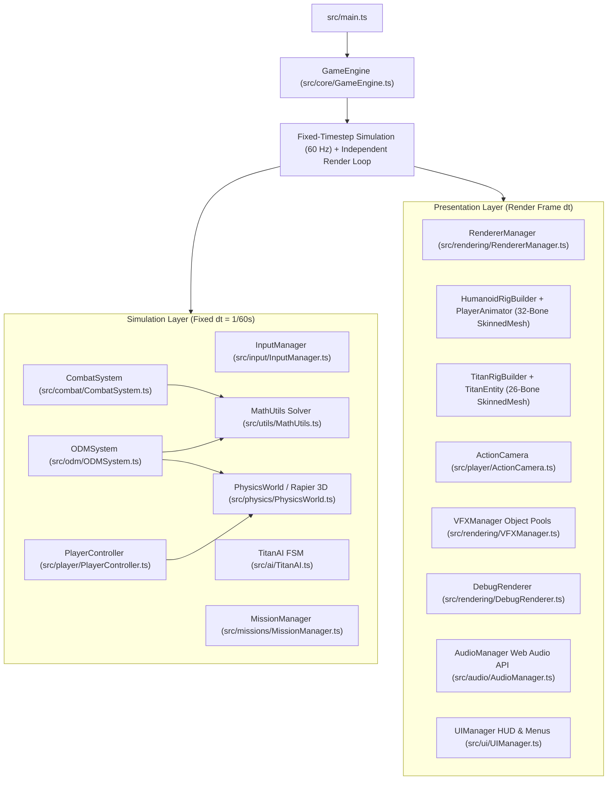

# TITAN HUNTER 3D — TECHNICAL ARCHITECTURE & EXTENSION GUIDE

## 1. High-Level System Architecture

**Titan Hunter 3D** is engineered around a strict separation between **Simulation State (Physics, ODM Math, Combat Sweep, AI FSM, Mission Logic)** and **Presentation State (Three.js Scene Graph, Skeletal Animation Blending, Particle Pools, DOM HUD)**.

---

## 2. Directory & Module Breakdown

| Directory / File | Responsibility |
|---|---|
| `src/core/GameEngine.ts` | Master lifecycle coordinator, fixed-timestep physics accumulator (`60 Hz`), hit-stop frame controller, and state transitions (`menu`, `playing`, `paused`, `result`). |
| `src/core/SaveManager.ts` | Persists `UserSettings` (sensitivity, camera distance, quality preset, audio volume, debug flags) and `SaveProgress` (high score, best rank, total kills) in `localStorage`. |
| `src/core/EventBus.ts` | Lightweight publish-subscribe event bus for decoupled notifications. |
| `src/config/GameConfig.ts` | Centralized configuration dictionary for physics constants, ODM wire parameters, combat damage multipliers, Titan variant stats, camera damping, and world dimensions. |
| `src/physics/PhysicsWorld.ts` | Wraps `@dimforge/rapier3d-compat` `World`, `KinematicCharacterController` (with autostep, slope limits, and wall-sliding), static city colliders, and filtered raycasting. |
| `src/odm/ODMSystem.ts` | Independent Left & Right grappling hook targeting (direct raycast + multi-ray `aimAssistCone` fan + moving Titan bone-anchor tracking), 3D steel wire rendering, and constraint integration. |
| `src/utils/MathUtils.ts` | Pure, unit-tested mathematical solvers: `solveODMRopeConstraints`, `sweptBladeIntersectsHurtbox`, `evaluateNapeApproachCos`, and `calculateStrikeDamage`. |
| `src/animation/HumanoidRigBuilder.ts` | Constructs the 32-bone humanoid `THREE.Skeleton`, anatomical `THREE.SkinnedMesh`, hip-mounted ODM gear, hand-parented dual mono-blades, and all 18 `THREE.AnimationClip`s. |
| `src/animation/PlayerAnimator.ts` | Manages `THREE.AnimationMixer` action crossfading plus procedural post-animation bone adjustments (velocity banking on `Spine1`, arm aiming toward active grapple anchors, cape wind flutter). |
| `src/enemies/TitanRigBuilder.ts` | Constructs the 26-bone Titan `THREE.Skeleton` & `THREE.SkinnedMesh` for `Normal`, `Abnormal`, and `Large` variants (`6.5m – 15m`), bone-attached hurtbox nodes (`Nape`, `Head`, `LeftArm`, `RightArm`, `LeftLeg`, `RightLeg`), and 10 skeletal animations. |
| `src/enemies/TitanEntity.ts` | Manages per-Titan anatomical hurtbox HP, limb regeneration timers, `Neck`-parented `Nape` weak-point world transform synchronization, and animation playback. |
| `src/ai/TitanAI.ts` | Finite-State Machine (`Idle -> Patrol -> Detect -> Chase -> Attack -> Recover`, plus `Grab`, `Stunned`, `Injured`, `Dead`), FOV/sound detection, obstacle avoidance, and injury behavior shifts. |
| `src/combat/CombatSystem.ts` | Samples world-space swept blade segments (`hilt -> tip`) during active attack frames against Titan hurtbox spheres, enforces rear-angle Nape execution, triggers hit-stop, and tracks combos. |
| `src/player/ActionCamera.ts` | Spring-arm third-person camera with mouse orbit, Rapier wall-collision raycast pull-in, speed-based dynamic FOV (`62° -> 86°`), soft target lock framing, and trauma shake. |
| `src/world/CityBuilder.ts` | Generates the `300m × 300m` fortified European city of Valkenburg with outer walls, 60+ modular buildings, central bell tower, supply depots, training rings, and `InstancedMesh` trees. |
| `src/rendering/VFXManager.ts` | Object-pooled particle emitters for gas propulsion steam trails, dual-blade crescent slash arcs, blood/spark impacts, and Titan evaporation steam. |
| `src/rendering/DebugRenderer.ts` | Real-time 3D debug wireframes for Titan hurtboxes, Nape weak points, grapple anchors, player capsule collider, and velocity vectors. |
| `src/audio/AudioManager.ts` | Web Audio API procedural sound synthesizer (hook piston fire, metal latch, gas thruster hiss, sword slash, critical nape ring, Titan footsteps & roars, resupply chime). |

---

## 3. Extension Guide (Models, Animations, Maps & Missions)

### 3.1 How to Add or Replace 3D Character / Titan `.glb` Models
1. Place your rigged `.glb` file in `public/assets/models/` (for example, `public/assets/models/custom_scout.glb`).
2. Load it in `GameEngine.init()` via `this.assetLoader.loadGLTF('/assets/models/custom_scout.glb')`.
3. In `HumanoidRigBuilder.ts` (or `TitanRigBuilder.ts`), bind the loaded `SkinnedMesh` and map its bone names (`Hips`, `Spine1`, `Neck`, `Head`, `LeftHand`, `RightHand`, `LeftLowerLeg`, `RightLowerLeg`):
   - Attach `leftSword.swordGroup` to `bonesByName['LeftHand']` and `rightSword.swordGroup` to `bonesByName['RightHand']`.
   - For Titans, attach `napeNode` to `bonesByName['Neck']` at local offset `(0, 0.02, -0.12)` so the Nape weak point tracks the skeleton automatically.

### 3.2 How to Add New Skeletal Animations
1. Author a new `THREE.AnimationClip` in `HumanoidRigBuilder.buildAllAnimations()` (or load it from `gltf.animations`).
2. Add the clip name to `PlayerAnimName` in `src/animation/HumanoidRigBuilder.ts`.
3. Register its loop mode (`THREE.LoopOnce` or `THREE.LoopRepeat`) in `PlayerAnimator.ts` and trigger it via `player.animator.playState('YourNewAnim', 0.15)`.

### 3.3 How to Create New Maps or Districts
1. In `src/world/CityBuilder.ts`, create a new layout method (e.g., `buildForestOfGiantTrees()` or `buildHarborDistrict()`).
2. For every grappleable structure (giant tree trunks, fortress walls, towers), register a static collider via `this.physics.addStaticBox(...)` or `this.physics.addStaticCylinder(...)` with `{ type: 'building', grappleable: true }`.
3. Populate `this.supplyStations`, `this.titanSpawnPoints`, and `this.patrolWaypoints` for the new map.

### 3.4 How to Add New Game Modes & Missions
1. Add your mode identifier to `GameMode` in `src/missions/MissionManager.ts` (e.g., `'endless_wave'` or `'defend_gate'`).
2. Configure the wave roster in `MissionManager.spawnHuntWave()` using any combination of `'normal'`, `'abnormal'`, and `'large'` Titans with custom heights (`5m – 15m`).
3. Update `MissionManager.getStatus()` to return the mode's HUD objective text and rank thresholds.
