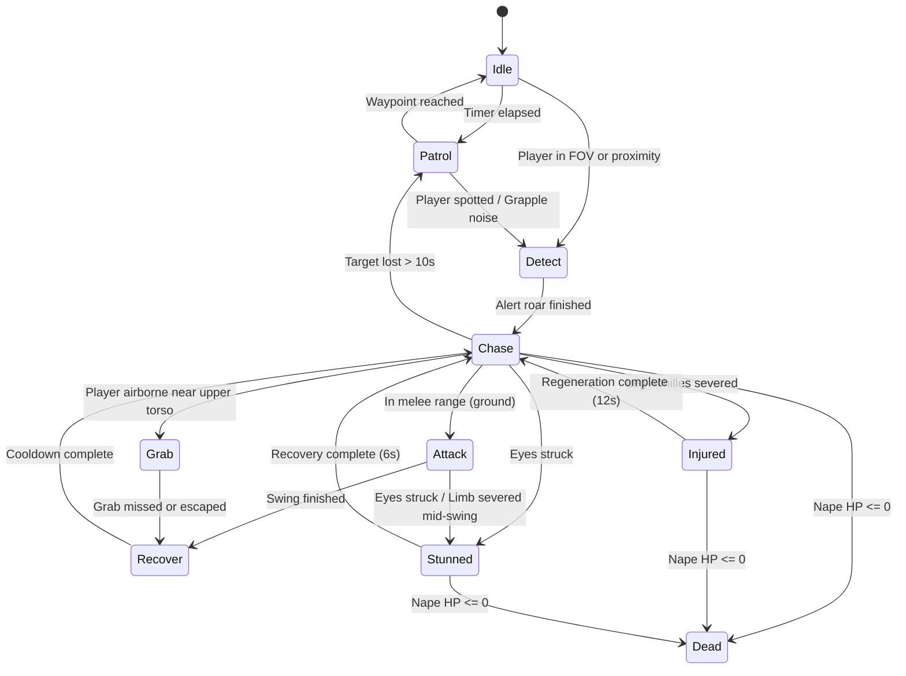

# TITAN HUNTER 3D — GAME DESIGN DOCUMENT (GDD)

## 1. Executive Vision & Core Pillars

**Titan Hunter 3D** (codename: *Aegis of the Walls*) is a high-speed, third-person 3D aerial action game built for the web with **Three.js**, **TypeScript**, and **Rapier 3D**. Inspired by *Attack on Titan 2: Final Battle*, the player assumes the role of an elite **Vanguard Strider** equipped with an **Omni-Directional Mobility (ODM) Rig** and dual replaceable high-carbon mono-blades, defending the walled European-style city of **Valkenburg** against towering humanoid **Behemoths (Titans)**.

### Core Design Pillars
1. **High-Speed Momentum & Pendulum Flow:** Every swing converts gravitational potential energy into tangential kinetic energy. Dual grappling hooks allow asymmetric orbits, slingshots through narrow streets, and vertical vaults over rooftops.
2. **Asymmetric Scale & Precision Lethality:** Titans range from 6m to 15m tall and cannot be killed by ordinary strikes. Only a high-velocity, well-angled slash across the **Cervical Core (Nape Weak Point)** executes a Titan, while severing **Limbs (Achilles/Legs, Arms, Eyes)** cripples their locomotion or neutralizes lethal grab attacks.
3. **Tactile Feedback & Readability:** Dynamic speed-based camera FOV, air-stream ribbons, gas propulsion trails, hit-stop frames on impact, directional slash arcs, and real-time anchor reticle feedback ensure the player always understands their trajectory and strike window.
4. **Resource Tension in Combat:** Gas pressure fuels both hook reel-in tension and thruster boosts; blades dull and chip with each strike, Especially against non-weak-point flesh, requiring strategic **Supply Tower** resupplies mid-hunt.

---

## 2. Deep-Dive Mechanics Research & Specifications

### 2.1 Omni-Directional Mobility Gear (ODM) Architecture
The ODM rig worn at the character's waist and lower back comprises:
- **Dual Coiled Wire Winches (Left & Right Hip Launchers):** Independent pistons that fire high-tensile steel cables up to `85m`.
- **Compressed Gas Cylinders (Twin Hip Tanks):** Fuel both rapid cable retraction (reel-in torque) and the rear directional main thruster nozzle.
- **Dual Scabbard Boxes & Quick-Release Blades:** Hold spare segmented blades (`6 pairs` max capacity) and feed into the twin handgrips with trigger mechanisms for wire firing and gas bursts.

### 2.2 Dual Grappling Hooks & Aerial Maneuvering
- **Independent Left (`LMB`) & Right (`RMB`) Hook Control:**
  - The player can fire, hold, or release each wire independently.
  - **Targeting Solver:** Uses a multi-ray cone fan centered on the camera reticle (plus contextual bias toward the locked-on Titan part or nearest valid architectural edge within `6°` cone) so high-speed grappling feels responsive without requiring pixel-perfect stationary clicking.
  - **Valid Surfaces:** City walls, building facades, roofs, watchtowers, trees, supply depots, and Titan body parts.
- **Single-Wire vs. Dual-Wire Dynamics:**
  - **Single Wire (Left or Right):** Creates an offset pivot point, naturally inducing a curved banking arc around buildings or circling a Titan's flank to reach its nape.
  - **Dual Wires (Left + Right simultaneously):** Computes an effective resultant tension vector toward the midpoint between both anchors while stabilizing lateral sway, enabling rapid straight-line slingshot launches between two buildings or high-speed zip-dashes directly into a Titan's neck.

### 2.3 Momentum-Based Swinging & Gas Propulsion Physics
Unlike naive teleportation or linear interpolation, ODM flight is governed by a semi-implicit Euler / Verlet-constrained rigid-body velocity solver running at a fixed physics step (`60 Hz`):

1. **Gravitational Acceleration:**
   $$\mathbf{v}_{t+\Delta t} = \mathbf{v}_t + \mathbf{g} \Delta t, \quad \mathbf{g} = (0, -22.0\text{ m/s}^2, 0)$$
   While at least one wire is anchored and taut, effective gravity is subtly scaled (`0.72x`) due to upward lift from continuous wire tension and hip-thruster stabilization.
2. **Slack vs. Taut Rope Constraint:**
   - Each active wire $i \in \{L, R\}$ tracks its current rest length $L_i$ (initialized to the distance at hook attachment) and actual distance $d_i = \|\mathbf{p}_{\text{anchor}, i} - \mathbf{p}_{\text{player}}\|$.
   - **Slack Condition ($d_i \le L_i$):** The wire exerts **zero** push force (a flexible cable cannot push), only mild reel-in tension if the player is actively retracting or steering.
   - **Taut Condition ($d_i > L_i$):** Any outward radial velocity component $\mathbf{v}_{\text{rad}} = (\mathbf{v} \cdot \hat{\mathbf{r}}_i)\hat{\mathbf{r}}_i$ (where $\hat{\mathbf{r}}_i$ points from anchor to player) is removed and converted into tangential swing speed, accompanied by a spring-damper position correction so the player arcs smoothly without jitter or position snapping.
3. **Active Reel-In & Tangential Steering:**
   - Holding a grapple button slowly reels in the wire ($\dot{L}_i = -18\text{ m/s}$, accelerated to $-34\text{ m/s}$ during Gas Boost), pulling the player along $\hat{\mathbf{u}}_i = -\hat{\mathbf{r}}_i$ while preserving tangential momentum.
   - `WASD` input during swing applies lateral/tangential thrust perpendicular to the wire vector, enabling helical orbits around Titans and sharp street-corner turns.
4. **Gas Propulsion (Boost — `Shift`):**
   - Consumes gas at `14 units/sec` (out of `100` max, upgradeable/refillable).
   - Applies a strong directional acceleration (`38 m/s²`) blended between camera look direction, movement input, and active hook pull vector, clamping terminal speed to `52 m/s` (`~187 km/h`) with smooth aerodynamic drag (`c_d = 0.018`).

### 2.4 Titan Combat, Weak-Point Targeting & Limb Damage
Titans are massive regenerative entities whose only fatal vulnerability is the **Nape of the Neck** (`1m × 0.35m` cervical nerve bundle attached to the local transform of the Titan's `Neck`/`UpperSpine` bone).

#### Targetable Anatomical Zones (Hurtboxes per Titan)
| Part | Location (Bone Local) | Gameplay Effect on Break | Fatal? |
|---|---|---|---|
| **Nape (Weak Point)** | Posterior `Neck` / `Spine2` (`-Z` local offset) | Instant execution if damage $\ge$ Nape HP threshold | **YES** |
| **Left Leg (Achilles)** | `LeftLowerLeg` | Titan collapses to knees (`Injured` state for `12s`), lowering nape near ground level and halting chase | No |
| **Right Leg (Achilles)** | `RightLowerLeg` | Same; breaking both legs extends downed state to `18s` | No |
| **Left Arm** | `LeftLowerArm` | Disables left-handed swipe & grab attacks for `15s` | No |
| **Right Arm** | `RightLowerArm` | Disables right-handed smash & grab attacks for `15s` | No |
| **Head / Eyes** | `Head` anterior | Blinds & stuns Titan (`Stunned` state for `6s`), cancelling active windups | No |

#### Kinetic Damage Formula
Damage is never flat; it rewards momentum, approach angle, and blade condition:
$$\text{Damage} = B_{\text{attack}} \times M_{\text{velocity}} \times M_{\text{angle}} \times M_{\text{sharpness}} \times M_{\text{zone}}$$
- **Base Attack ($B_{\text{attack}}$):** `180` (Light Slash) or `310` (Spinning Heavy Aerial Slash when boosting).
- **Velocity Multiplier ($M_{\text{velocity}}$):** $0.6 + \text{clamp}(\|\mathbf{v}_{\text{rel}}\| / 18.0, 0, 2.4)$, where $\mathbf{v}_{\text{rel}} = \mathbf{v}_{\text{player}} - \mathbf{v}_{\text{titan}}$. High-speed swoops deal up to `3.0x` damage!
- **Approach Angle Multiplier ($M_{\text{angle}}$):** For the Nape hurtbox, checks alignment with the Titan's rear hemisphere ($\text{dot}(\hat{\mathbf{d}}_{\text{approach}}, \mathbf{f}_{\text{titan}})$). Frontal hits cannot clip through the throat to hit the nape; true posterior strikes gain a `1.5x` Critical Nape bonus.
- **Blade Sharpness ($M_{\text{sharpness}}$):** `1.0` when durability $> 25\%$, dropping to `0.35` when blades are dull (`0%`), requiring `R` blade reload/resupply.

#### Active Blade Sweep Collision (No Distance-Only Shortcuts)
During the active frames (`normalizedTime` $\in [0.22, 0.68]$) of `Light Attack` or `Heavy Attack`, the combat solver samples the world-space segment between the left/right sword hilts and blade tips (plus an swept arc volume across the previous frame's blade positions) against the oriented bounding capsules/spheres of each Titan anatomical hurtbox.

### 2.5 Titan Variants & Finite-State Machine (FSM) AI

#### Three Distinct Titan Archetypes
1. **Normal Titan (6m – 9m):**
   - **Behavior:** Methodical lumbering walk during patrol, steady jog when chasing, telegraphed overhead slam and horizontal sweep attacks.
   - **Stats:** Nape HP `350`, Limb HP `220`, Walk Speed `3.8 m/s`, Chase Speed `7.2 m/s`.
2. **Abnormal Titan (7m – 11m):**
   - **Behavior:** Erratic, twitchy posture; sprints unpredictably with sudden zig-zag lateral jukes, leaping lunges toward airborne players, and high-reaching anti-air snatch grabs.
   - **Stats:** Nape HP `480`, Limb HP `260`, Walk Speed `5.5 m/s`, Sprint/Lunge Speed `14.5 m/s`.
3. **Large / Colossal-Class Vanguard Titan (13m – 15m):**
   - **Behavior:** Towering juggernaut with heavy crimson-scarred musculature, huge shockwave ground-stomp AoE, wide sweeping backhand that knocks players out of the sky, and reinforced Nape threshold requiring a high-speed boosted slash or crippling its legs first.
   - **Stats:** Nape HP `820`, Limb HP `420`, Walk Speed `3.2 m/s`, Chase Speed `5.8 m/s`, Attack Reach `9.5m`.

#### AI State Machine

### 2.6 Camera, Animation Blending & Cinematic Combat
- **Spring-Arm Action Camera:**
  - Orbit controlled by mouse (`PointerLock` during active gameplay) with pitch clamped to `[-68°, +75°]`.
  - Smooth damped follow target anchored at the player's upper spine plus a velocity look-ahead offset so the player sees upcoming buildings clearly at `45 m/s`.
  - **Wall Collision Protection:** Casts a sphere/ray from character pivot to desired camera position against world building colliders; pulls the camera inward immediately on obstruction and eases back out smoothly.
  - **Dynamic Speed FOV:** Interpolates camera FOV from `62°` (grounded idle) up to `86°` (full gas boost swing) accompanied by radial wind-streak particles.
  - **Target Lock-On (`Tab` / Middle Mouse):** Soft-locks camera yaw/pitch bias toward the selected Titan hurtbox (defaulting to **Nape**, cyclable across **Nape -> Left Leg -> Right Leg -> Left Arm -> Right Arm -> Head** via `Q/E` target cycle or mouse wheel) without fighting the player's swing steering.
- **Skeletal Animation & Procedural Layering:**
  - `THREE.AnimationMixer` drives 18 skeletal animation clips with smooth `crossFadeTo` transitions (`0.12s – 0.25s`).
  - **Procedural Additive Post-Pass (after `mixer.update`):**
    1. **Velocity Banking:** Tilts the character's `Spine` and `Hips` roll/pitch proportional to lateral centripetal acceleration.
    2. **Grapple Arm Aiming:** Rotates left/right shoulder & forearm bones toward active left/right wire anchor positions when hooks are deployed.
    3. **Blade Attachment:** Dual swords are parented directly to `LeftHand` and `RightHand` bones (and scabbards to `Hips`).

### 2.7 Mission Progression, Scoring, Resupply & Survival
- **Game Modes:**
  1. **Training Mode (Cadet Proving Grounds):**
     - Guided 5-stage interactive course with live check-off objectives:
       - *Stage 1:* Ground locomotion, sprint, and jump (`WASD`, `Space`).
       - *Stage 2:* Left & Right grapple targeting on training towers (`LMB`, `RMB`).
       - *Stage 3:* Momentum pendulum swing & Gas Boost through aerial ring checkpoints (`Shift`).
       - *Stage 4:* Target Lock-On & Supply Depot blade/gas replenishment (`Tab`, `R`).
       - *Stage 5:* Live combat drill — sever a Training Dummy Titan's leg or execute a high-speed Nape slash (`F`).
  2. **Titan Hunt Mode (Defense of Valkenburg District):**
     - Multi-wave district defense across the `300m × 300m` fortified city.
     - **Wave 1 (Vanguard Breach):** 3 Normal Titans + 1 Abnormal Titan.
     - **Wave 2 (Hunting Pack):** 3 Normal Titans + 2 Abnormal Titans + 1 Large Titan.
     - **Wave 3 (Colossal Assault):** 2 Normal Titans + 3 Abnormal Titans + 2 Large Titans.
     - **Supply Towers:** Marked with rising cyan/gold beacons on the HUD; pressing `R` within `8m` refills Gas (`100%`), Spare Blades (`6/6`), and restores `40%` Health.
- **Scoring & Rank System:**
  - Points awarded for Nape Kills (`1000 × Speed Multiplier`), Limb Breaks (`350`), Perfect Dodges (`250`), Combo Streak Multiplier (`1.0x` to `3.0x`), and Clear Time Bonus.
  - Ranks: **S Rank**, **A Rank**, **B Rank**, **C Rank**, persisted to `localStorage` along with user settings (Mouse Sensitivity, Camera Distance, Graphics Quality Preset, Audio Volume, Debug Overlays).
