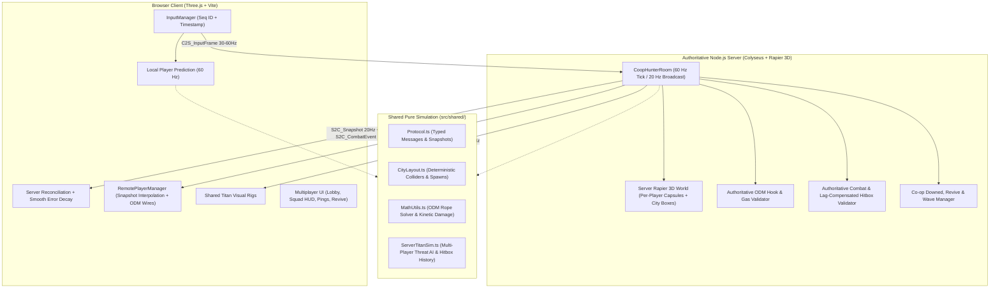

# TITAN HUNTER 3D — MULTIPLAYER CO-OP ARCHITECTURE

## 1. Executive Summary & Design Goals

This document defines the real-time **2–4 Player Co-op Multiplayer Architecture** for **Titan Hunter 3D**. The multiplayer upgrade transforms the existing single-player vertical slice into a **Server-Authoritative Co-op Action Game** powered by **Node.js + Colyseus + Rapier 3D**, while preserving 100% backward compatibility with the offline **Training Mode** and **Single-Player Titan Hunt Mode**.

### Core Engineering Principles
1. **Strict Server Authority:** The server owns all canonical state for player positions, velocities, ODM grapple anchors, gas pressure, blade durability, Titan AI, anatomical hurtbox HP, damage calculation, downed/revive timers, and mission waves. Clients never dictate damage, kills, health, or teleports.
2. **Zero-Latency Local Feel (Client-Side Prediction + Server Reconciliation):** Because high-speed ODM swinging at `50 m/s` requires instantaneous visual feedback, the local client predicts its own physics and ODM rope constraints at `60 Hz` and reconciles smoothly against authoritative server snapshots (`20 Hz`) using sequence-numbered input history.
3. **Smooth Remote Entities (Snapshot Interpolation + Bounded Extrapolation):** Remote teammates (`2–4 players`) and shared Titans are rendered using buffered snapshot interpolation (`85ms` interpolation window) with bounded velocity dead-reckoning (`<= 180ms`) to mask network jitter and packet loss.
4. **Clean Three-Layer Separation (`Shared` / `Server` / `Client`):** All simulation math, city collider layouts, ODM constraint solvers, and combat formulas live in `src/shared/` with zero browser/DOM dependencies so the exact same Rapier 3D and vector math runs on both Node.js and the browser.

---

## 2. Codebase Review & Refactoring Map

| Existing Module | Review Analysis | Multiplayer Refactoring Strategy |
|---|---|---|
| `src/config/GameConfig.ts` | Pure configuration constants | Shared directly between Client and Server (`co-op` revive, tick rate, and aggro constants added). |
| `src/utils/MathUtils.ts` | Pure ODM rope solver (`solveODMRopeConstraints`) & combat math (`sweptBladeIntersectsHurtbox`, `calculateStrikeDamage`) | Shared directly between Client and Server for deterministic ODM and combat evaluation. |
| `src/physics/PhysicsWorld.ts` | Rapier 3D wrapper + character capsule controller + raycasting | Used by both Client (for local prediction) and Server (for authoritative multi-player capsules & grapple raycasts). |
| `src/world/CityBuilder.ts` | Mixed Three.js mesh creation (`CanvasTexture`, `InstancedMesh`) with Rapier collider registration | Extracted pure collider & spawn layout into **`src/shared/CityLayout.ts`** so the Node.js server builds the exact same 3D city colliders without DOM/WebGL. |
| `src/odm/ODMSystem.ts` | Combined raycast/constraint math with Three.js wire meshes | Server uses pure raycast + `solveODMRopeConstraints`; Client `ODMSystem` renders local wires while **`RemotePlayerManager`** renders 3D ODM wires for teammates. |
| `src/enemies/TitanEntity.ts` & `TitanAI.ts` | Combined `SkinnedMesh` animation mixer with AI FSM | Extracted pure server-side kinematic bone/hurtbox solver and multi-target aggro FSM into **`src/shared/ServerTitanSim.ts`**. Client syncs `TitanEntity` rigs from server state in Co-op mode. |
| `src/combat/CombatSystem.ts` | Sampled local sword world positions against hurtboxes | Client sends `C2S_AttackIntent`; Server validates cooldown, range, bounded hitbox history, and rear Nape angle before broadcasting `S2C_CombatEvent`. |
| `src/ui/UIManager.ts` | Single-player menus & HUD | Extended with Co-op Lobby UI (Create/Join by 6-char room code, Public/Private toggle, Ready status, Player list), Teammate HUD (3D overhead markers, HP/Downed bars, Ping/RTT, Quick Chat), and Revive progress ring. |

---

## 3. Three-Layer System Architecture

---

## 4. Network Protocol, Tick Rates & Bandwidth Budget

- **Server Simulation Tick Rate:** `60 Hz` (`fixedDt = 16.67ms`).
- **Client Input Transmission Rate:** `30–60 Hz` (`C2S_InputFrame` with monotonically increasing `seq`).
- **Server State Broadcast Rate:** `20 Hz` (`50ms` interval, sending compact `NetRoomState` delta/snapshot).
- **Payload Discipline:** Skeletal bone matrices (`32 × 16 floats`) and scene meshes are **never** transmitted over the network. Each player state transmits only compact kinematic vectors (`position`, `velocity`, `yaw`), discrete animation enum (`PlayerAnimName`), resource integers (`health`, `gas`, `bladeDurability`), and active hook endpoints (`leftHook`, `rightHook`).

---

## 5. Client-Side Prediction, Reconciliation & Remote Interpolation

### 5.1 Local Player Prediction & Server Reconciliation
1. On every local simulation step, the client assigns `seq = ++inputSeq`, records `{ seq, input, predictedPos, predictedVel }` in a 120-entry circular buffer, and steps the local `PlayerController` + `ODMSystem` immediately.
2. When the server processes `C2S_InputFrame`, it updates `player.lastAckedSeq = frame.seq` and includes it in the next `S2C_Snapshot`.
3. Upon receiving `S2C_Snapshot`:
   - The client looks up the historical predicted state matching `lastAckedSeq`.
   - Computes position discrepancy $\Delta \mathbf{p} = \mathbf{p}_{\text{server}} - \mathbf{p}_{\text{predicted}}(\text{lastAckedSeq})$.
   - If $\|\Delta \mathbf{p}\| > 0.35\text{m}$, the client snaps the physics state to $\mathbf{p}_{\text{server}}$, replays all unacknowledged inputs (`seq > lastAckedSeq`), and accumulates the visual delta into `visualErrorOffset`, which decays exponentially ($\text{damp}(\mathbf{e}, \mathbf{0}, 18, dt)$) so corrections are visually seamless without rubber-banding.

### 5.2 Remote Player Interpolation & Bounded Extrapolation
- Each remote player stores a timestamped snapshot buffer (`snapshots: Array<{ timeMs, state }>`).
- Render time is evaluated at $t_{\text{render}} = t_{\text{now}} - 85\text{ms}$:
  - **Interpolation:** When two bracketing snapshots $S_0 \le t_{\text{render}} \le S_1$ exist, position, velocity, and yaw are linearly/angularly interpolated.
  - **Bounded Dead-Reckoning Extrapolation:** If packets are delayed ($t_{\text{render}} > S_{\text{latest}}$), position is extrapolated along $\mathbf{v}_{\text{latest}}$ for at most `180ms` (`maxExtrapolationMs`) with gravity/damping before clamping, preventing remote players from freezing mid-air or flying through walls during packet loss.

---

## 6. Authoritative Combat, Lag Compensation & Co-op Mechanics

### 6.1 Bounded Server-Side Hitbox History
- The server records a 24-tick (`400ms`) ring buffer of all Titan hurtbox world positions (`Nape`, `Head`, `LeftArm`, `RightArm`, `LeftLeg`, `RightLeg`).
- When `C2S_AttackIntent` arrives from a player, the server clamps the player's measured RTT offset to `[0ms, 200ms]`, retrieves the Titan's hurtbox positions at that historical tick, and verifies:
  1. Player is `'alive'` and attack cooldown has elapsed.
  2. Distance between the player's server-authoritative position and the hurtbox is within valid blade reach (`bladeReach + hurtbox.radius + velocityAllowance`).
  3. For `Nape` strikes, `evaluateNapeApproachCos(playerServerPos, titanPos, titanForward) <= napeCriticalAngleCos`.
  4. If the Titan is already `Dead` on this tick, subsequent strikes from other teammates are ignored to prevent double-kill race conditions.

### 6.2 Co-op Downed, Revive & Kill/Assist Attribution
- **Kill & Assist Tracking:** Every Titan maintains a `damageContributors: Map<playerId, totalDamage>` ledger. When a Titan's Nape is severed, the executing player earns `+1 Kill`, while any teammate who dealt damage to that Titan's limbs or nape earns `+1 Assist` and a `40%` score share.
- **Downed & Revive State Machine:**
  - Fatal damage from a Titan puts a player into `lifeState = 'downed'` (`30s` bleed-out timer) as long as at least one teammate remains `'alive'`.
  - Any `'alive'` teammate within `4.5m` holding `E` (`reviveHeld = true`) charges `reviveProgress` (`2.5s` duration). Taking damage interrupts the revive. Completing the revive restores the downed teammate to `50% HP`.
