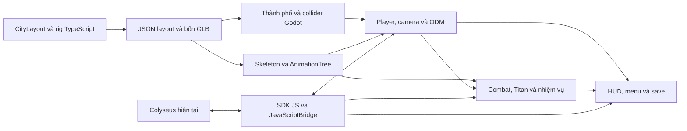

# Kiến trúc migration Godot

Baseline Three.js và backend là `6836b594c8460566e0305ebf461ca993ffb735bf`. Bản Godot sống trong `godot-client/` trên nhánh `codex/godot4-migration`. Đích chính là WebAssembly và WebGL 2 với Godot 4.7.2 Standard, Compatibility và Web export một luồng. GDScript sở hữu game loop, UI và gameplay. Trình duyệt chạy SDK Colyseus hiện tại qua JavaScriptBridge. [Godot 4.7.2](https://godotengine.org/download/archive/4.7.2-stable/), [Godot Web export](https://docs.godotengine.org/en/stable/tutorials/export/exporting_for_web.html)

## Ánh xạ module

| Three.js | Godot | Hợp đồng |
|---|---|---|
| `GameEngine`, `InputManager`, `ActionCamera` | `scenes/game.gd`, `player/player.gd`, `player/orbit_camera.gd` | Node chính điều phối menu, match và lifecycle. Player lấy input ở tick vật lý, camera xử lý chuột, zoom, FOV, khóa mục tiêu và tránh tường. |
| `GameConfig`, `CityLayout`, `CityBuilder` | `tools/export-game-data.ts`, `resources/game_data.json`, `world/city.gd` | Layout và các tham số dùng chung xuất trực tiếp từ TS. Y hướng lên, toạ độ và tỷ lệ thành phố theo mét, cùng vị trí collider. |
| `PhysicsWorld`, `WorldGrappleSolver`, `ODMSystem` | `player/player_motion.gd`, `player/rope_solver.gd`, `player/odm_controller.gd` | Capsule có gốc ở chân. CharacterBody3D giải tiếp xúc, lực kéo và giới hạn dây do bộ giải ODM xử lý ở 60 Hz. Hai móc có trạng thái, vật cản và thời điểm retry riêng. |
| `HumanoidRigBuilder`, `TitanRigBuilder`, `PlayerAnimator` | `tools/bake-rigs.mts`, 4 GLB, `player/player_animation.gd`, `player/player_pose.gd` | Bake mesh, material, skin, bind pose, clip và socket từ rig gốc. Model nhìn theo +Z. Vanguard dùng AnimationTree và SkeletonModifier3D. Titan dùng AnimationPlayer và socket gắn xương. |
| `CombatSystem`, `TitanEntity`, `TitanAI` | `combat/combat.gd`, `combat/titan.gd` | Kiếm lấy mẫu quét từ socket mỗi tick, damage theo vận tốc và góc Nape. AI solo dùng state machine và ray tránh chướng ngại. Trong co-op, server sở hữu HP, hành vi Titan và projectile. |
| `MissionManager`, `SaveManager`, `UIManager`, HUD và marker | `missions/mission.gd`, `ui/` | Signals chuyển kết quả nhiệm vụ, sát thương, input và sự kiện UI. Save dùng `user://vanguard.cfg`, nhập dữ liệu localStorage cũ khi chạy cùng origin lần đầu. |
| `AudioManager`, `VFXManager`, `DebugRenderer` | `audio/cues.gd`, `combat/effects.gd`, công cụ debug từ Settings | SFX tái tạo theo tham số gốc. Pool có giới hạn cho hạt, cung chém và các voice. Foliage dùng MultiMesh. |
| `NetworkClient`, `RemotePlayerManager` | `multiplayer/coop_client.gd`, `web-bridge.ts`, `remote_squad.gd`, `player/input_prediction.gd` | Browser dùng `NetworkClient.ts` cùng SDK JS để join và decode message. Godot gửi input và attack intent, dùng snapshot server và replay input chưa ACK qua collision Godot. |

## Phụ thuộc và thứ tự triển khai

1. Khóa baseline, import Godot và xác minh khả năng xuất Web.
2. Dùng cùng nguồn dữ liệu thành phố và bake rig để khóa hợp đồng tọa độ, socket và clip.
3. Chạy movement, camera, ODM và Training qua scene thật. Nối combat, Titan, Hunt và feedback.
4. Kết nối adapter với backend gốc. Kiểm tra hai browser client, ACK, snapshot, sự kiện và reconnect.
5. Kiểm tra lặp từ menu, visual, export và benchmark. Đánh giá giới hạn theo từng hàng của ma trận parity.

## Quyền quyết định trạng thái và networking

Trong solo, `TitanPlayer`, `TitanCombat`, `TitanActor` và `TitanMission` sở hữu phần trạng thái tương ứng. Trong co-op, simulation và luật xác thực của `CoopHunterRoom` quyết định sát thương, vị trí chính thức, HP, ammo, down/revive và mission. Client dự đoán movement, sửa sai theo `lastAckedSeq`, đồng bộ từng móc theo ACK và nội suy đồng đội với bộ đệm 85 ms. Godot và Rapier có thuật toán tiếp xúc khác nhau nên sai số còn cần đo dưới RTT và packet loss.

Adapter giữ matchmaking, session token, socket, reconnect và custom message binary do SDK JS xử lý. Game hiện dùng custom `room_snapshot` và `combat_event`, được giải mã qua SDK JS. SDK Godot chính thức có Web support theo tài liệu 0.18, còn đường tích hợp đã kiểm chứng dùng SDK JS đang được repo khóa để giữ tương thích phiên bản hiện tại. Adapter bù PI cho yaw trên `input_frame` để khớp cách chuẩn hóa hiện có của server. Co-op native chưa có adapter. [Colyseus SDK cho Godot](https://docs.colyseus.io/getting-started/godot), [JavaScriptBridge](https://docs.godotengine.org/en/stable/classes/class_javascriptbridge.html)

## Chiến lược kiểm tra

- Kiểm thử dữ liệu và thuật toán với bố cục collider, vector ODM từ TS, góc Nape, lưỡi cùn và swept blade.
- Kiểm thử engine với import GLB, socket và pose, collision, input, camera, vòng đời nhiệm vụ, audio PCM, VFX và nội suy.
- Kiểm thử browser với export thực tế, điều khiển, canvas, pointer lock, console, settings và kết nối backend cục bộ. Hai browser context dùng session độc lập.
- So sánh hiệu năng ở cùng browser, kích thước, chất lượng và kịch bản. Báo kết quả phần mềm và GPU thật riêng.
